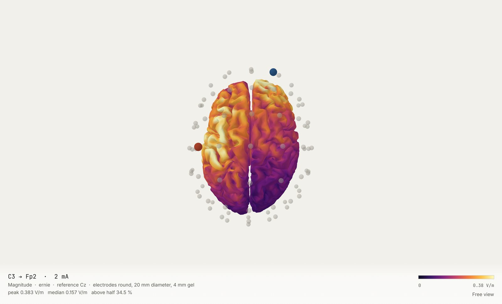

# E-Field Lab

Browser-based simulation of the electric field induced on the cortex by transcranial
electric stimulation. Pick a montage, get the field. No installation, no account, no
server: the computation runs in the page.

[](https://github.com/Omega-Collective/omega-efield-lab/actions/workflows/tests.yml)
[](LICENSE)

**Live: [omegadym.com/efield-lab](https://omegadym.com/efield-lab/)** ·
Method and limits: [omegadym.com/efield](https://omegadym.com/efield)



## Why it exists

Field modelling for tES is well solved — SimNIBS does it properly — but a full
simulation takes long enough that comparing four candidate montages during planning is
a chore. Most people skip it and place electrodes by convention.

The trick is that the problem is linear. The field of any electrode combination is the
weighted sum of the single-electrode solutions. So the expensive part is done once, and
everything after that is a dot product. That is what this repository packages: the
pipeline that computes a leadfield with SimNIBS, the exporter that turns it into a
compact web format, and the viewer that recombines it in real time.

## What you get

- Any montage over the 76 electrodes of the 10-10 system, evaluated instantly
- Magnitude and the normal component of the field on the cortical surface
- Peak (99th percentile), median and focality (share of cortex above half the peak)
- PNG export with a caption stating the model, reference electrode and electrode geometry
- Everything self-contained: no CDN, no external requests, no tracking

## Repository layout

```
tools/compute_leadfield.py   SimNIBS leadfield computation (the slow step, ~1.5 h)
tools/export_leadfield.py    HDF5 -> compact web format (model.json + two binaries)
tools/run_pipeline.bat       Both steps, for Windows; drag a head mesh onto it
tools/run_5x5.bat            Same, with 50 x 50 mm rectangular electrodes
js/                          The viewer (ES modules, no build step)
css/                         Styles
vendor/                      three.js, vendored
models/                      Exported models the viewer loads
```

## Reproducing a model

You need SimNIBS 4.6 and a head mesh — the `ernie` example dataset that ships with
SimNIBS works, and is what the published model uses.

```bash
simnibs_python tools/compute_leadfield.py path/to/ernie.msh -o leadfield_ernie
simnibs_python tools/export_leadfield.py leadfield_ernie/*.hdf5 -o models/ernie --name ernie
```

The first step solves 76 finite-element problems and takes about an hour and a half on
a normal desktop; roughly half of that is meshing the electrodes onto the scalp. The
second step decimates the cortical surface, resamples the leadfield onto it and writes
about 9 MB.

Electrode geometry is fixed when the leadfield is computed, not in the viewer, because
it changes the current density at the scalp and therefore the field. Defaults are round,
20 mm diameter, 4 mm gel. For rectangular pads:

```bash
simnibs_python tools/compute_leadfield.py ernie.msh -o leadfield_5x5 \
    --forma rect --ancho 50 --alto 50
```

The geometry is recorded in `electrode.json`, carried into `model.json`, shown in the
sidebar, and printed on every exported figure. A figure that does not state its
electrode geometry cannot be compared with one that does.

## Serving it

Static files, so anything works:

```bash
python -m http.server 5000
```

Then open `http://localhost:5000/`. The viewer loads `models/<name>/` and takes
`?model=<name>` to switch. Listing several models in `models/index.json` makes a model
picker appear in the sidebar.

## Installing

Nothing to install to *use* it — open the live page, or clone and serve the folder.

To reproduce a model you need [SimNIBS 4.6](https://simnibs.github.io/simnibs/) and, for
the exporter, Python with `numpy`, `h5py`, `scipy` and `fast_simplification`:

```bash
pip install numpy h5py scipy fast_simplification
```

On Windows the `tools/*.bat` scripts find SimNIBS on their own; drag a head mesh onto
`run_pipeline.bat`.

## Tests

```bash
# formato e invariantes fisicas de los modelos exportados
pip install numpy pytest && python -m pytest tests -v

# aritmetica del visor, sin navegador
node --test tests/viewer.test.mjs

# la pagina carga y calcula un montaje, en un navegador real
npm install --no-save playwright && npx playwright install chromium
node tests/smoke.mjs
```

The first suite checks that a model's declared metadata matches its binaries, that the
reference electrode row is zero, that linear superposition is exact, and that peak field
values land in a physiologically plausible range. The second exercises the viewer
arithmetic against a hand-built model with a known answer. The third loads the published
model in Chromium and verifies, among other things, that an HD 4x1 array comes out more
focal than a two-electrode montage.

All three run in CI on every push.

## Contributing

See [`CONTRIBUTING.md`](CONTRIBUTING.md). Bug reports, montage presets and new head
models are all welcome; issues are the right place for questions about the method too.

## Limits

Worth reading before a number from this ends up in a paper.

- **One head model.** Values are indicative, not subject-specific. Different skull
  thickness or anatomy gives different numbers.
- **Fixed electrode geometry.** A 5 × 5 cm sponge montage spreads the same current over
  eight times the area and is not reproduced by a 20 mm model.
- **Decimated surface**, ~309,000 vertices down to ~20,000. Fine sulcal detail is smoothed.
- **Cortical surface only.** No values for deep structures.
- **float16 storage**, which introduces small but non-zero rounding.

Linear superposition itself is *not* an approximation — it is exact for the quasi-static
ohmic problem SimNIBS solves. The approximations are in the list above.

This is not a medical device and does not replace a subject-specific simulation.

## Citing

See [`CITATION.cff`](CITATION.cff). Please also cite SimNIBS:

> Thielscher, A., Antunes, A., & Saturnino, G. B. (2015). Field modeling for transcranial
> magnetic stimulation: a useful tool to understand the physiological effects of TMS? *37th Annual International Conference of the IEEE EMBC.*

## License

MIT, see [`LICENSE`](LICENSE). The bundled three.js build keeps its own MIT license in
`vendor/three.LICENSE`. Head models from the SimNIBS example dataset are subject to
SimNIBS's own terms.

---

Built at [Omega Dynamics](https://omegadym.com).
